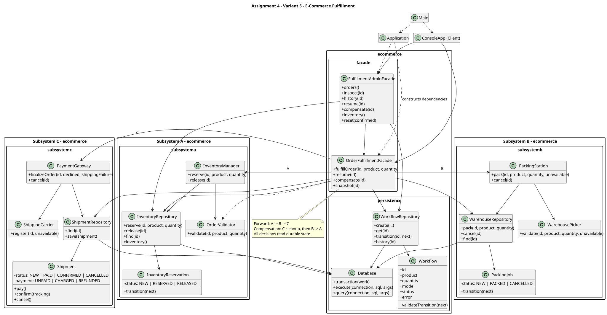

# Assignment 4: Facade Over a Three-Stage Chain

Variant **5 — E-Commerce Fulfillment**, Java 17, Maven, SQLite/JDBC, JUnit 5, JaCoCo and PlantUML.

This console application validates an order, reserves inventory, packs it, then simulates payment and shipping. Two facades hide the coordination. Each stage commits to an on-disk SQLite database independently. If a later stage fails, the facade reads persisted records and reverses the work already committed. You can stop between stages, restart the JVM, and resume or compensate the same order.

## Open and run in IntelliJ IDEA

1. Open this directory's `pom.xml` as a Maven project, or right-click it and choose **Add as Maven Project** in the existing project. Reload Maven.
2. In **File → Project Structure → Project**, select JDK 17 and language level 17. Use **Add SDK → Download JDK → 17** if necessary. Also select JDK 17 for Maven Runner in Settings. No preview features are required.
3. Run `ecommerce.Main` from `src/main/java/ecommerce/Main.java`. Set the run configuration's working directory to the project root.
4. The console prints the absolute database path. The default is `fulfillment.db` in the working directory. Optional program argument: an existing directory plus a database filename, for example `C:/temp/fulfillment-demo.db`.
5. Enter menu numbers and answer the prompts. Initial products: BOOK 100, LAPTOP 20, MOUSE 50. Use a unique order ID for each new order.

The old IntelliJ preview-language starter has been replaced with a standard Java 17 main method. Existing local IDE settings are ignored by Git; importing the Maven project establishes the source and test roots.

## Build and run commands

Set `JAVA_HOME` to a JDK 17 installation. The official Maven Wrapper downloads Maven 3.9.9 on first use; dependencies also need internet on the first build. After downloading, the application itself runs offline.

Windows PowerShell (replace the JDK path with your installation):

```powershell
$env:JAVA_HOME = "C:\path\to\jdk-17"
$env:Path = "$env:JAVA_HOME\bin;$env:Path"
.\mvnw.cmd clean verify
.\mvnw.cmd compile exec:java
java -jar target/Assignment4-SDP-Turar-1.0.0.jar
```

On macOS/Linux use `./mvnw` instead. If Maven is installed, these are equivalent:

```text
mvn clean verify
mvn test
mvn jacoco:report
mvn compile exec:java
```

`test` runs JUnit and creates the coverage report; `verify` also packages the executable JAR and enforces at least **80% line coverage separately for each subsystem package and the facade package**. Open `target/site/jacoco/index.html`. Machine-readable results are `target/site/jacoco/jacoco.xml` and `jacoco.csv`. The shaded JAR includes SQLite JDBC.

## Complete project structure

```text
Assignment4-SDP-Turar/  (the local directory is as4_sdp_turar_d)
├── .gitignore
├── .mvn/wrapper/maven-wrapper.properties
├── mvnw
├── mvnw.cmd
├── pom.xml
├── README.md
├── docs/
│   ├── class-diagram.puml
│   ├── class-diagram.svg
│   ├── class-diagram.png
│   ├── verification.md
│   └── demo-transcript.txt
└── src/
    ├── main/java/ecommerce/
    │   ├── Main.java
    │   ├── Application.java
    │   ├── cli/ConsoleApp.java
    │   ├── facade/
    │   │   ├── OrderFulfillmentFacade.java
    │   │   └── FulfillmentAdminFacade.java
    │   ├── persistence/
    │   │   ├── Database.java
    │   │   ├── Workflow.java
    │   │   └── WorkflowRepository.java
    │   ├── exception/
    │   │   ├── FulfillmentException.java
    │   │   ├── ValidationException.java
    │   │   ├── StageException.java
    │   │   └── PersistenceException.java
    │   ├── subsystema/
    │   │   ├── InventoryReservation.java
    │   │   ├── OrderValidator.java
    │   │   ├── InventoryManager.java
    │   │   └── InventoryRepository.java
    │   ├── subsystemb/
    │   │   ├── PackingJob.java
    │   │   ├── WarehousePicker.java
    │   │   ├── PackingStation.java
    │   │   └── WarehouseRepository.java
    │   └── subsystemc/
    │       ├── Shipment.java
    │       ├── ShippingCarrier.java
    │       ├── PaymentGateway.java
    │       └── ShipmentRepository.java
    └── test/java/ecommerce/
        ├── SubsystemTest.java
        ├── FulfillmentTest.java
        └── ConsoleTest.java
```

Generated `target/`, runtime databases, IntelliJ settings, and temporary files are ignored. Do not submit or commit those directories. The reproducible coverage summary is in `docs/verification.md`.

## Subsystems and facades

Each subsystem contains **four top-level classes**, 12 total. Nested status enums are owned by their entities. There are no imports or calls between the subsystem packages.

| Layer | State entity | Pure business logic | Service | Persistence gateway |
| --- | --- | --- | --- | --- |
| A | InventoryReservation | OrderValidator checks IDs and positive quantities | InventoryManager reserves/releases stock | InventoryRepository |
| B | PackingJob | WarehousePicker checks picking requests and station availability | PackingStation packs/cancels jobs | WarehouseRepository |
| C | Shipment | ShippingCarrier deterministically provides tracking or fails | PaymentGateway charges, finalizes, refunds | ShipmentRepository |

`OrderFulfillmentFacade` sequences A → B → C, saves workflow progress, catches domain failures and performs compensation. `FulfillmentAdminFacade` presents a narrower administrative interface for inspection, history, inventory, reset, resume, and manual compensation. `Application` constructs dependencies; `ConsoleApp` only talks to the facades. `Database` provides JDBC mechanics without knowing any domain services. Each repository executes its own SQL directly through this shared low-level helper.

A and B have `NEW → RESERVED → RELEASED` and `NEW → PACKED → CANCELLED` transitions respectively. A/B `NEW` objects are transient within the stage transaction. C persists `NEW → PAID → CONFIRMED`; any non-cancelled C state may become `CANCELLED`. Cancellation changes a charged payment to `REFUNDED`, retains `UNPAID` for a decline, and clears tracking. Repeating the current transition is harmless. Backward transitions such as RELEASED → RESERVED and CANCELLED → PACKED are rejected by the entities themselves.

## Durable workflow and recovery

| Current workflow state | Allowed next states |
| --- | --- |
| NEW | PENDING_B, FAILED, COMPENSATING |
| PENDING_B | PENDING_C, COMPENSATING |
| PENDING_C | COMPLETED, COMPENSATING |
| COMPLETED | COMPENSATING (simulated cancellation) |
| FAILED | COMPENSATING (manual cleanup) |
| COMPENSATING | COMPENSATED |
| COMPENSATED | None |

Same-state transitions are allowed for retries. `FAILED` represents a domain failure before any subsystem work was committed, such as insufficient stock. Invalid basic input is rejected before creating a workflow. Reusing an order ID is rejected; use resume for an existing order.

Tables: `inventory`, `reservations`, `jobs`, `shipments`, `workflows`, and `history`. Workflow mode, status, error, and timestamped history are durable. A stock decrement and its reservation insert are one transaction; a release and its stock increment are another. There is **no transaction spanning the entire chain**. Database connections are opened and closed for each operation. Each successful stage is already durable when the next begins.

Recovery reads workflow status and replays the unfinished stage. Subsystem operations recognize previously saved IDs and check their input/state, so a crash after a stage commit but before its workflow update does not duplicate stock reservations, packing, or payment. Compensation checks actual subsystem rows rather than trusting in-memory flags. The history records snapshots before compensation and each successful undo. A crash between an undo and its audit event can cause the event to be retried; durable entity states make the undo itself idempotent. Sequence numbers establish event order even when timestamps are equal.

If a database write fails, `PersistenceException` propagates and the last durable state remains available. Compensation first persists COMPENSATING. It does not release A if cancelling B fails. If refund persistence fails, C retains PAID/CHARGED; the order remains recoverable, and retrying manual compensation records the refund before reversing B and A. Tests inject SQLite trigger failures to verify these cases. Do not remove the database to recover an interrupted order.

## Live demonstration

Use BOOK and quantity 3 unless specified. Choose unique IDs such as `success-1`, `b-1`, `c-1`.

| Menu | Action and expected evidence |
| --- | --- |
| 1 | Normal order: COMPLETED, A RESERVED, B PACKED, C CONFIRMED/CHARGED. Stock decreases by 3. |
| 4 | B unavailable after A commits: failure snapshot shows A RESERVED and B ABSENT. A becomes RELEASED, workflow COMPENSATED, stock restored. No B cancellation event. |
| 5 | C payment decline after A/B commit: snapshot shows A RESERVED, B PACKED, C NEW. History records C cleanup, **B_CANCELLED before A_RELEASED**. Stock restored, payment UNPAID. |
| 13 | Carrier failure after charge: payment becomes REFUNDED; B and A are compensated. |
| 11 | Pause after A: PENDING_B. Exit with 0, start again using the same database path, inspect with 3, resume with 6. |
| 12 | Pause after B: PENDING_C. Restart and either resume with 6 or compensate with 7. |
| 7 | Manually compensate an order. Repeat and verify stock is not restored twice. |
| 2 / 3 / 8 | List orders / inspect states and complete history / inspect inventory. |
| 9 | Shows how to run the independent subsystem demonstrations as JUnit tests. |
| 10 | Reset only after typing the exact confirmation `RESET`. Other input cancels. |

For additional failures, use quantity 0, unknown product `UNKNOWN`, or quantity 101 for a fresh BOOK inventory. Invalid menu choices and nonnumeric quantities do not crash the CLI. All simulation modes are selected through the menu; source edits are unnecessary.

Reset deletes all records and reseeds stock in one local transaction. Alternatively, stop the application and delete its printed database file for a fresh demonstration. Never reset another operator's data.

## Tests and coverage

Run `./mvnw test` or Windows `.\mvnw.cmd test`. For independent subsystem demonstrations, run `.\mvnw.cmd -Dtest=SubsystemTest test`. The three standalone subsystem tests instantiate and call each subsystem directly, without either facade.

F.I.R.S.T.:

- **Fast:** embedded SQLite, small data, no external services or sleeps. Runtime can vary with filesystem/antivirus overhead.
- **Independent:** every test receives its own JUnit `@TempDir` database.
- **Repeatable:** deterministic failure switches, fixed seed stock, no network during tests.
- **Self-validating:** assertions check actual persisted states, inventory, refunds, recovery, and history order.
- **Timely:** local Git stages pair subsystem implementation with its tests and orchestration with workflow/CLI tests. This records tests alongside code; it does not claim a historical test-first process.

The domain-specific helper methods `givenProductWithStock(10)`, `whenOrderIsFulfilled(3)` and `thenInventoryShouldBe(7)` make a successful workflow test read like the domain. Tests cover both compensation depths, entity transitions, durable reload, manual compensation, refund failure, failed compensation writes, and commit/update interruption gaps. See [measured results](docs/verification.md); coverage is measured, not inferred from test count. Line coverage does not mean every possible failure has been tested.

## Principle of Least Knowledge

Without the facade, a client using our actual classes would need these collaborators and would have to implement progress tracking and error handling too:

```java
var db = new Database(Path.of("fulfillment.db"));
var inventory = new InventoryManager(new InventoryRepository(db), new OrderValidator());
var packing = new PackingStation(new WarehouseRepository(db), new WarehousePicker());
var payments = new PaymentGateway(new ShipmentRepository(db), new ShippingCarrier());
inventory.reserve("order-1", "BOOK", 3);
packing.pack("order-1", "BOOK", 3, false);
payments.finalizeOrder("order-1", false, false);
// The client would also need to save progress and undo B then A after failure.
```

With the facade, the composition root supplies one collaborator:

```java
OrderFulfillmentFacade fulfillment = new Application(Path.of("fulfillment.db")).fulfillment();
fulfillment.fulfillOrder("order-1", "BOOK", 3);
```

The CLI never navigates through repositories or coordinates subsystem services. It receives the facade references in its constructor. Inspection uses the second facade.

## Facade versus Adapter

An Adapter translates an existing interface into another interface a client expects. Our problem is different: inventory reservation, warehouse packing, and payment/shipping are already usable services, but completing an order requires an ordered operation across all three. The client should not know their sequencing, persistence checkpoints, or reverse-order compensation rules. `OrderFulfillmentFacade` provides that simpler entry point. `FulfillmentAdminFacade` exposes the smaller management view. They preserve the independent subsystems and coordinate them without pretending that they are interchangeable. An Adapter could later translate a real carrier SDK into our shipping interface, but that translation would not replace the facade's workflow and compensation responsibilities.

## Design decisions and limits

- State entities own legal transitions; pure rule classes are separate from SQL gateways. Constructor injection separates assembly from orchestration. The CLI has one responsibility: interaction.
- Concrete collaborators keep this small university project understandable. This is not a claim of complete Dependency Inversion or Open/Closed compliance: substituting a genuinely different storage or payment provider would warrant extracting a small interface. No generic framework or Spring container is needed.
- This is a **single-operator CLI**, not a concurrent server. Do not run two writers against the same database simultaneously. Transactions protect each local stage, but there is no distributed lock or optimistic workflow version.
- Payment and carrier behavior is deterministic simulation. A CHARGED/REFUNDED database record models the effect; no real money, parcel, or external API is involved. Completed shipments can be cancelled in this simulator; a real carrier needs cancellation eligibility and external idempotency keys.
- Payment records live with shipments in one table, including UNPAID/CHARGED/REFUNDED. This makes their simulated consistency explicit without an unnecessary second entity.
- Pauses represent interruptions at durable boundaries. Additional tests recreate the smaller gaps between a stage commit and workflow update; they do not prove resilience to disk corruption or machine power loss.
- Recovery is explicit through the admin menu, not an automatic background worker. Permanent infrastructure failures must be fixed before retrying. The database parent directory must already exist.
- The previous visible assignments used email construction, coffee service, and food-delivery notifications; this implementation uses e-commerce fulfillment. Only the student/instructor can confirm domain approval and originality across all submissions. Nothing has been pushed or submitted to Moodle.

## UML



The editable source is [class-diagram.puml](docs/class-diagram.puml); [PNG](docs/class-diagram.png) is included for viewers without SVG support. PlantUML's Smetana engine renders it without Graphviz:

```text
java -jar plantuml.jar -tsvg docs/class-diagram.puml
java -jar plantuml.jar -tpng docs/class-diagram.puml
```

The diagram shows all 12 subsystem classes, both facades, the CLI, composition root, state objects and persistence associations. Exception classes and nested enums are omitted for readability; enum states are shown on their entities.

## Five defense questions

1. **Why is this a Facade?** One client call coordinates three different services, including sequencing and recovery. It simplifies using them together.
2. **What happens if C fails?** The facade reads saved records, cleans up C, cancels B, then releases A. Every undo changes SQLite state.
3. **How does restart work?** The database retains the workflow checkpoint and subsystem records. Resume replays the unfinished step safely.
4. **Why not wrap everything in one transaction?** The assignment requires earlier stages to commit before later failures. Compensation reverses these committed effects with new transactions.
5. **How do you avoid restoring inventory twice?** The release transaction checks reservation state. It changes RESERVED to RELEASED and increments stock together; a later release sees RELEASED and does nothing.
